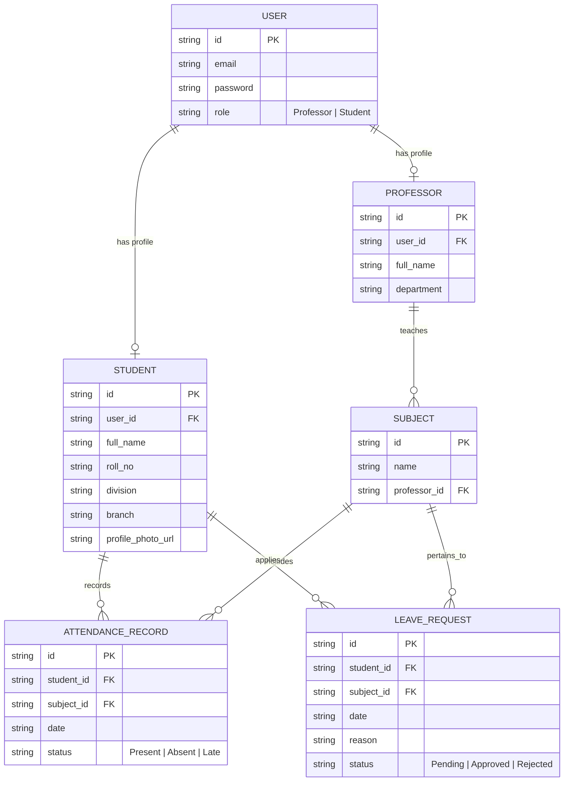

<div align="center">

  

  # 🎓 Apex College Attendance Portal

  **A Next-Gen, Role-Based College Attendance & Analytics Web & Mobile Platform**

  [](https://manearyan5222.github.io/college-attendance-system/)
  [](https://github.com/manearyan5222/college-attendance-system)
  [](#-mobile--pwa-features)
  [](#-android-native-wrapper)

</div>

---

## 🌟 Overview

**Apex College Attendance Portal** is a feature-rich, high-performance role-based attendance management system built for educational institutions. Designed with a mobile-first, dark-theme glassmorphism aesthetic, it empowers **Professors** with rapid attendance logging and leave approvals, while giving **Students** deep visual analytics, attendance goal planning ("Can I skip next class?"), and absence justification tracking.

> [!TIP]
> **Try the Live Application Now:** [https://manearyan5222.github.io/college-attendance-system/](https://manearyan5222.github.io/college-attendance-system/)

---

## 🔑 Key Features

### 👨‍🏫 For Professors / Faculty
- **⚡ Rapid Attendance Grid**: High-speed toggle buttons (`Present` / `Absent` / `Late`) with live color badges.
- **🔍 Live Student Search**: Filter student cards dynamically by name or roll number.
- **✅ Bulk Marking**: 1-Tap `Mark All Present` or `Mark All Absent` options for fast entry.
- **📝 Leave Approvals**: Review and approve/reject student absence & medical leave applications.
- **📊 Real-Time Class Stats**: Live statistics bar calculating class attendance percentage before submission.
- **📥 Dual CSV Exporter**: 
  - **All-Time CSV Export**: Download full course attendance logs.
  - **Monthly CSV Export**: Select any month/year to generate a breakdown report containing daily logs and monthly student percentages.

### 👨‍🎓 For Students
- **📊 Interactive Gauges & Radial Charts**: SVG percentage rings and Chart.js doughnut charts per subject.
- **🧮 Attendance Goal Calculator ("Can I Skip Next Class?")**: 
  - Set target thresholds (e.g. 75%, 80%, 85%).
  - Automatically calculates **Safe Bunk Budget** or exact **Required Consecutive Classes** to reach eligibility.
- **📅 Monthly Calendar Heatmap**: Visual 7-column calendar showing daily presence (`Green`), absence (`Red`), or late (`Yellow`) dots.
- **📝 Leave Application System**: Submit formal absence justifications (e.g., medical certificates, athletic events) directly to course professors.
- **🔍 Searchable Attendance Logs**: Live search & status filters (`Present`, `Absent`, `Late`).
- **⚠️ Shortage Warning Banners**: Automatic alert badges when attendance in any subject drops below mandatory **75% semester exam threshold**.

### 📱 Mobile & PWA Experience
- **📱 Floating Bottom App Bar**: Native iOS/Android style bottom navigation bar on smartphones.
- **📲 Progressive Web App (PWA)**: Installable directly to mobile home screens with offline caching via `sw.js`.
- **⚡ 1-Click Quick Switcher**: Integrated top nav dropdown to switch between Demo Professor and Student accounts instantly.

---

## 🔐 Demo Credentials

Use these pre-seeded accounts to log in and test both roles:

| Role | Name | Email | Password | Details / Assigned Subjects |
| :--- | :--- | :--- | :--- | :--- |
| **Professor** | Dr. Sarah Jenkins | `sarah.jenkins@college.edu` | `password123` | Computer Networks, Software Engineering, Web Dev |
| **Professor** | Dr. David Miller | `david.miller@college.edu` | `password123` | Database Systems, Artificial Intelligence |
| **Student** | **Aryan Mane** | `aryan.mane@college.edu` | `password123` | Roll No. 59 | Div A | Computer Engineering |
| **Student** | Jessica Taylor | `jessica.taylor@college.edu` | `password123` | Roll No. 01 | Div A | Computer Engineering |

---

## 🗄️ Relational Database Schema

The client-side `localStorage` engine maintains standard relational data structures:



---

## 📂 Repository Structure

```
college-attendance-system/
├── index.html              # Main Single Page Application (SPA) layout & UI templates
├── app.js                  # Core business logic, localStorage DB, analytics, & CSV exporter
├── manifest.json           # Progressive Web App (PWA) configuration
├── sw.js                   # Service Worker for offline asset caching
├── app_icon.jpg            # High-resolution PWA and app launcher icon
├── README.md               # Project documentation
└── college-attendance-android/ # Native Android Studio wrapper (Jetpack Compose)
```

---

## 🛠️ Local Setup & Running

### Option 1: Web Application
1. Clone or download the repository:
   ```bash
   git clone https://github.com/manearyan5222/college-attendance-system.git
   ```
2. Open `index.html` directly in any modern web browser (Chrome, Edge, Firefox, Safari).

### Option 2: Mobile PWA Installation
1. Open [https://manearyan5222.github.io/college-attendance-system/](https://manearyan5222.github.io/college-attendance-system/) on your smartphone.
2. Tap **Share** (iOS Safari) or **Settings (⋮)** (Android Chrome).
3. Select **"Add to Home Screen"**.

### Option 3: Android Native Wrapper
1. Open the `./college-attendance-android` directory in **Android Studio**.
2. Sync Gradle dependencies and run on an Android Emulator or physical device.

---

## 🤝 Contributing & License

Designed and developed by **[Aryan Mane](https://github.com/manearyan5222)**.  
Licensed under the **MIT License**.
