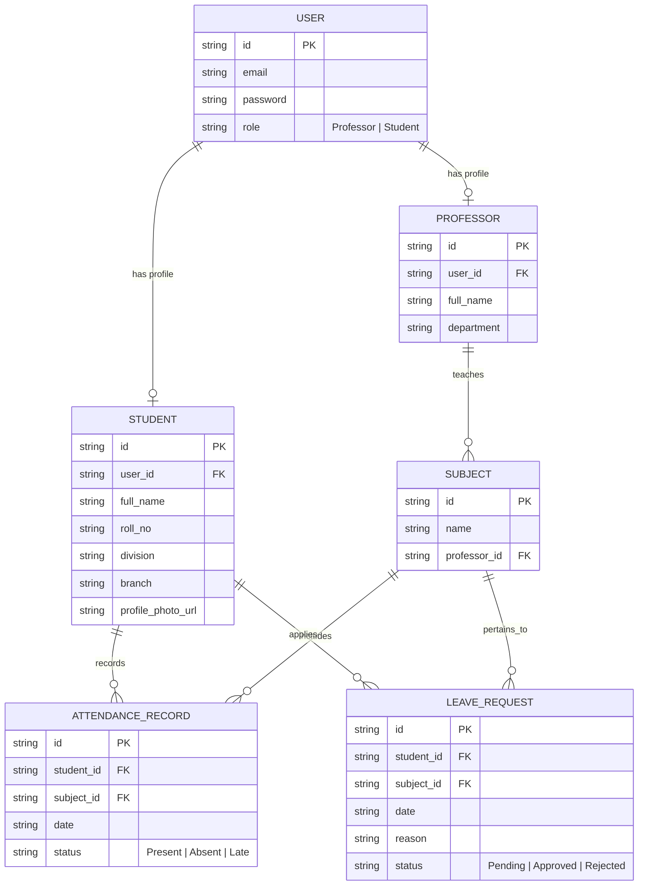

<div align="center">

  

  # 🎓 Apex College Attendance Portal

  **A Next-Gen, Role-Based College Attendance & Analytics Web & Mobile Platform**

  [](https://manearyan5222.github.io/college-attendance-system/)
  [](https://github.com/manearyan5222/college-attendance-system)
  [](#-mobile--pwa-experience)
  [](#-android-native-wrapper)

</div>

---

## 🌟 Overview

**Apex College Attendance Portal** is a feature-rich, high-performance role-based attendance management system built for educational institutions. Designed with a mobile-first, dark-theme glassmorphism aesthetic, it supports **7 Teacher Accounts** and **70 Student Accounts** across **14 Courses** with **30 Days of Historical Attendance Data**.

> [!TIP]
> **Try the Live Application Now:** [https://manearyan5222.github.io/college-attendance-system/](https://manearyan5222.github.io/college-attendance-system/)

---

## 🔑 Key Features

### 👨‍🏫 For Professors / Faculty (7 Accounts)
- **⚡ Rapid Attendance Grid**: High-speed toggle buttons (`Present` / `Absent` / `Late`) with live color badges.
- **🔍 Live Student Search**: Filter student cards dynamically by name or roll number.
- **✅ Bulk Marking**: 1-Tap `Mark All Present` or `Mark All Absent` options for fast entry.
- **📝 Leave Approvals**: Review and approve/reject student absence & medical leave applications.
- **📊 Real-Time Class Stats**: Live statistics bar calculating class attendance percentage before submission.
- **📥 Dual CSV Exporter**: 
  - **All-Time CSV Export**: Download full course attendance logs.
  - **Monthly CSV Export**: Select any month/year to generate a breakdown report containing daily logs and monthly student percentages.

### 👨‍🎓 For Students (70 Accounts - S001 to S070)
- **📊 Interactive Gauges & Radial Charts**: SVG percentage rings and Chart.js doughnut charts per subject.
- **🧮 Attendance Goal Calculator ("Can I Skip Next Class?")**: 
  - Set target thresholds (e.g. 75%, 80%, 85%).
  - Automatically calculates **Safe Bunk Budget** or exact **Required Consecutive Classes** to reach eligibility.
- **📅 Monthly Calendar Heatmap**: Visual 7-column calendar showing daily presence (`Green`), absence (`Red`), or late (`Yellow`) dots.
- **📝 Leave Application System**: Submit formal absence justifications (e.g., medical certificates, athletic events) directly to course professors.
- **🔍 Searchable Attendance Logs**: Live search & status filters (`Present`, `Absent`, `Late`).
- **⚠️ Shortage Warning Banners**: Automatic alert badges when attendance in any subject drops below mandatory **75% semester exam threshold**.

### ⚙️ Admin & Data Management Panel
- **📊 Live Database Statistics**: Real-time counter of Teachers (7), Students (70), Subjects (14), Attendance Records, and Leaves.
- **📥 JSON Database Backup Export**: Download the complete database state as a JSON file with 1 click.
- **📤 JSON Database Backup Import**: Upload and restore a JSON database backup file to sync state across browsers.
- **🔄 Re-Seed Dataset**: Re-seeds default 70 students and 7 professors dataset cleanly.
- **🧹 Reset Attendance Records**: Clear attendance logs while preserving user accounts.

---

## 🔐 7 Teacher Accounts & Sample Credentials

All accounts use password: `password123`

| ID | Role | Name | Email | Department / Assigned Courses |
| :--- | :--- | :--- | :--- | :--- |
| `prof_1` | **Professor** | Dr. Sarah Jenkins | `sarah.jenkins@college.edu` | Computer Engineering (Networks, Software Eng) |
| `prof_2` | **Professor** | Dr. David Miller | `david.miller@college.edu` | Information Technology (Database Systems, Web Dev) |
| `prof_3` | **Professor** | Prof. Robert Chen | `robert.chen@college.edu` | AI & Data Science (Machine Learning, AI) |
| `prof_4` | **Professor** | Dr. Ananya Rao | `ananya.rao@college.edu` | Computer Engineering (DSA, Operating Systems) |
| `prof_5` | **Professor** | Prof. Marcus Vance | `marcus.vance@college.edu` | Cyber Security (Cybersecurity, Cloud Computing) |
| `prof_6` | **Professor** | Dr. Vikram Joshi | `vikram.joshi@college.edu` | Electronics & Telecom (Signal Proc, Embedded Sys) |
| `prof_7` | **Professor** | Prof. Elena Rostova | `elena.rostova@college.edu` | Mechanical Engineering (Robotics, Fluid Mech) |

---

## 👨‍🎓 70 Student Accounts (S001 to S070)

All student accounts use password: `password123`

| ID | Roll No | Name | Email | Branch | Division |
| :--- | :--- | :--- | :--- | :--- | :--- |
| `stud_1` | **59** | **Aryan Mane** | `aryan.mane@college.edu` | Computer Engineering | Div A |
| `stud_2` | 01 | Jessica Taylor | `jessica.taylor@college.edu` | Computer Engineering | Div A |
| `stud_3` | 02 | Rohan Sharma | `student03@college.edu` | Computer Engineering | Div A |
| `stud_4` | 03 | Priya Patel | `student04@college.edu` | Information Technology | Div B |
| `stud_5` | 04 | Liam Johnson | `student05@college.edu` | Computer Engineering | Div A |
| ... | ... | ... | ... | ... | ... |
| `stud_70` | 70 | Himansh Kohli | `student70@college.edu` | Computer Engineering | Div A |

*(Use the top navigation bar **1-Click Quick Account Switcher** to switch between any of the 77 accounts instantly!)*

---

## 🗄️ Relational Database Schema



---

## 🌐 Data Persistence & Cloud Shared DB Note

1. **Client-Side Persistence (`localStorage`)**:
   - Out-of-the-box zero config execution on GitHub Pages.
   - Saves all marked attendance and leaves locally per browser.
2. **Multi-Device JSON Sync**:
   - Use the **Admin / Data** panel to export `apex_college_attendance_db_backup.json` and import it on another device/phone.
3. **Shared Cloud Database Architecture (Supabase / Firebase)**:
   - For real-time multi-device cloud synchronization across smartphones, connect a shared backend REST API (Supabase Postgres or Firebase Firestore) using the backend bridge configuration.

---

## 🛠️ Local Setup & Running

1. Clone repository:
   ```bash
   git clone https://github.com/manearyan5222/college-attendance-system.git
   ```
2. Open `index.html` directly in any modern web browser.

---

## 🤝 Contributing & License

Designed and developed by **[Aryan Mane](https://github.com/manearyan5222)**.  
Licensed under the **MIT License**.
